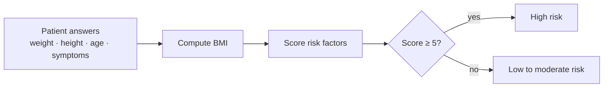

# 🩺 Diabetes Risk Expert System

**A rule-based system that assesses diabetes risk from a few simple questions.**
Patient inputs → BMI → risk score → risk level.

`8 risk factors` · `score-based diagnosis` · `3 test cases`

> This repository is a **project showcase**. Source code and the full report are private.
> Contact: albinajeti20@gmail.com

## Overview

Built in **CLIPS**, a forward-chaining rule engine. The system asks the patient a few questions, calculates BMI and adds points for each risk factor:

| Risk factor | Points |
|---|---|
| Fasting blood sugar ≥ 126 mg/dL | 2 |
| BMI > 28 | 1 |
| Age > 25 | 1 |
| Blurred vision | 1 |
| Tiredness | 1 |
| Family history of diabetes | 1 |
| Low physical activity | 1 |
| 3 or more pregnancies | 1 |

A total score of **5 or more means high risk**.

## Results

| Case | BMI | Age | Main factors | Score | Result |
|---|---|---|---|---|---|
| 1 | 25.4 | 20 | low activity | 1 | Low / moderate |
| 2 | 28.3 | 24 | BMI, low activity | 2 | Low / moderate |
| 3 | 37.0 | 37 | BMI, age, blurred vision, tiredness, family history | 5 | **High** |

The system classified all three test cases as expected.

## Next steps
- Calibrate the weights and the threshold on real clinical data
- Compare the rules with a machine-learning model (e.g. logistic regression)

© 2025 Albin Ajeti. All rights reserved. See [LICENSE](LICENSE).
